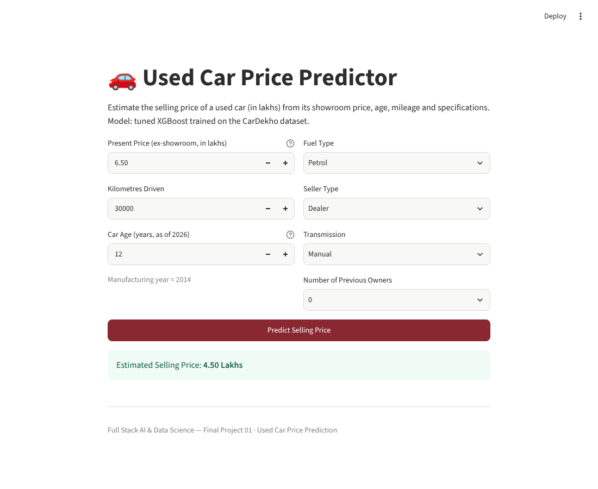

# Used Car Price Prediction

## Overview
An end-to-end machine learning project that predicts the selling price of a used car (in lakhs) from its
showroom price, age, mileage, fuel type, seller type, transmission and ownership history. The project covers
exploratory data analysis, leakage-free feature engineering with scikit-learn Pipelines, comparison and tuning of
five regression models with 5-fold cross-validation, a single final evaluation on a held-out test set, and an
interactive Streamlit web app.

## Dataset
- **Source:** [Kaggle – Vehicle Dataset from CarDekho](https://www.kaggle.com/datasets/nehalbirla/vehicle-dataset-from-cardekho) (`car data.csv`)
- **Features used:** Present_Price, Kms_Driven, Car_Age (= 2026 − Year), Owner, Fuel_Type, Seller_Type, Transmission
- **Dropped:** Year (replaced by Car_Age), Car_Name (98 unique values for 301 rows)
- **Target:** Selling_Price (lakhs)
- **Total samples:** 301 (299 after removing 2 exact duplicates); 239 train / 60 held-out test

## Key EDA Findings
- **Present_Price is the dominant predictor** (correlation ≈ 0.88 with Selling_Price) and the relationship is close to linear.
- **Selling_Price is right-skewed** (mean 4.66 vs median 3.60 lakhs, skewness ≈ 2.5), with a few luxury cars up to 35 lakhs.
- **Age drives depreciation**: 9-year-old cars keep ~90% of their showroom price, 13-year-old cars ~50%, cars 17+ years under ~30%. Year and Car_Age are perfectly redundant, so only Car_Age is kept.
- **Diesel, Automatic and Dealer-sold cars** have clearly higher median prices; these nominal features are one-hot encoded.
- **Kms_Driven and Owner are low-signal** (|r| < 0.1); Owner is ~96% zeros and CNG has only 2 rows. One listing reports an implausible 500,000 km.

## Model Comparison
5-fold `KFold(shuffle=True, random_state=42)` on the training split only; each model's whole preprocessing + model
pipeline is cross-validated and tuned with `GridSearchCV` on the same folds. Sorted by CV R².

| Model                                     | Train R2 (CV) | CV R2  | CV RMSE (lakhs) |
|-------------------------------------------|---------------|--------|-----------------|
| XGBoost (n=300, lr=0.05, depth=3)         | 0.9972        | 0.9046 | 1.4462          |
| LightGBM (min_child_samples=5, leaves=15) | 0.9871        | 0.8952 | 1.5430          |
| Random Forest (n_estimators=200)          | 0.9830        | 0.8929 | 1.5195          |
| Ridge (alpha=10.0)                        | 0.9047        | 0.8890 | 1.6069          |
| Linear Regression                         | 0.9069        | 0.8850 | 1.6451          |

Default-parameter baselines: XGBoost CV R² 0.8847, LightGBM CV R² 0.8163.

**Held-out test set (evaluated once, after model selection):**

| Final model | Test R2 | Test RMSE (lakhs) |
|-------------|---------|-------------------|
| XGBoost     | 0.8628  | 1.8804            |

## Final Model
**Model:** XGBoost Regressor (`n_estimators=300, learning_rate=0.05, max_depth=3`) inside a Pipeline with one-hot encoding (no scaling)
**Selected using:** highest mean 5-fold CV R² (0.9046) and lowest CV RMSE (1.45 lakhs)
**Final Test R2:** 0.8628
**Final Test RMSE:** 1.8804 lakhs
**Why this model:** Depreciation is non-linear and interacts with showroom price and age (older cars keep a smaller fraction of their price), and fuel/transmission shift that curve. Shallow boosted trees with a small learning rate capture these interactions better than additive linear models. Tree models show a train–CV gap of ~0.09 R², which reflects the small dataset, but they still generalise best. The test score is slightly below CV mainly because of two unusual test cars (a 33-lakh Fortuner and a 20-year-old Camry); with only 60 test rows a few cars move the score a lot. Feature importance (Present_Price ≈ 74%, Car_Age ≈ 15%, then Diesel and Automatic) matches the EDA.

## Web Application
Deployed using Streamlit.
**Live app:** https://YOUR-APP-NAME.streamlit.app

### Screenshots


## Project Structure
```
used-car-price-prediction/
├── data/car_data.csv
├── notebooks/
│   ├── 1_eda.ipynb
│   └── 2_training.ipynb
├── models/
│   ├── best_model.pkl        # fitted preprocessing + XGBoost pipeline
│   ├── cv_results.csv
│   └── test_metrics.csv
├── screenshots/streamlit_app.png
├── app.py
├── README.md
└── requirements.txt
```

## Installation
```bash
git clone https://github.com/YOUR-USERNAME/used-car-price-prediction.git
cd used-car-price-prediction
pip install -r requirements.txt
```
Use Python 3.12. Library versions are pinned so the saved pipeline loads with the same versions it was trained with.

## Usage
```bash
streamlit run app.py
```
To reproduce the analysis, run `notebooks/1_eda.ipynb` then `notebooks/2_training.ipynb` from inside the `notebooks/` folder.

## Technologies Used
- Python
- Pandas, NumPy, Matplotlib, Seaborn
- Scikit-learn, XGBoost, LightGBM
- Streamlit
